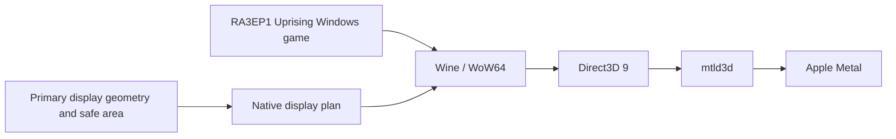

# RA3EP1Mac — Uprising

An unofficial compatibility project that runs the Windows edition of Command & Conquer: Red Alert 3 – Uprising (RA3EP1) on Apple Silicon Macs. It keeps the original game engine and runs it through Rosetta 2, Wine/WoW64, mtld3d and Metal, adapting the game to macOS fullscreen windows and notch safe areas.

This is an unofficial adaptation. See [third-party notices](THIRD-PARTY-NOTICES.md) for component provenance and licensing.

The game timing patch (frame-rate selection and timing corrections) is developed in the independent project [RA3EP1 FPS Unlock](https://github.com/Rakanrkk/RA3EP1-FPS-Unlock). This repository contains its macOS integration, packaging and release.

## Release editions

RA3EP1Mac 1.2.0 ships as a Standalone edition (complete, game included) and a Runtime edition (build it yourself). Release files appear on GitHub in this order:

| File | Purpose |
| --- | --- |
| [`RA3EP1Mac-v1.2.0-macos-arm64-runtime.dmg`](https://github.com/Rakanrkk/RA3EP1Mac/releases/download/v1.2.0/RA3EP1Mac-v1.2.0-macos-arm64-runtime.dmg) | Runtime edition (no game): Wine runtime, initialized prefix template, RA3Mac tools and app-building helpers; no game files, saves or assembled app. |
| [`RA3EP1Mac-v1.2.0-macos-arm64-standalone.001.dmg`](https://github.com/Rakanrkk/RA3EP1Mac/releases/download/v1.2.0/RA3EP1Mac-v1.2.0-macos-arm64-standalone.001.dmg) | Standalone edition (complete): ready-to-install app with runtime and game, native DMG volume 1 of 4. Keep all four parts in one directory with their original names; open only this `.001.dmg` and macOS reads the rest, no manual joining. |
| [`RA3EP1Mac-v1.2.0-macos-arm64-standalone.002.dmgpart`](https://github.com/Rakanrkk/RA3EP1Mac/releases/download/v1.2.0/RA3EP1Mac-v1.2.0-macos-arm64-standalone.002.dmgpart) | Standalone edition native DMG volume 2. |
| [`RA3EP1Mac-v1.2.0-macos-arm64-standalone.003.dmgpart`](https://github.com/Rakanrkk/RA3EP1Mac/releases/download/v1.2.0/RA3EP1Mac-v1.2.0-macos-arm64-standalone.003.dmgpart) | Standalone edition native DMG volume 3. |
| [`RA3EP1Mac-v1.2.0-macos-arm64-standalone.004.dmgpart`](https://github.com/Rakanrkk/RA3EP1Mac/releases/download/v1.2.0/RA3EP1Mac-v1.2.0-macos-arm64-standalone.004.dmgpart) | Standalone edition native DMG volume 4. |
| [`RA3EP1Mac-v1.2.0-wine-source.tar.zst`](https://github.com/Rakanrkk/RA3EP1Mac/releases/download/v1.2.0/RA3EP1Mac-v1.2.0-wine-source.tar.zst) | Wine source archive matching the Runtime edition, with RA3Mac patches. |
| [`release-manifest.json`](https://github.com/Rakanrkk/RA3EP1Mac/releases/download/v1.2.0/release-manifest.json) | Release file manifest. |
| [`SHA256SUMS.txt`](https://github.com/Rakanrkk/RA3EP1Mac/releases/download/v1.2.0/SHA256SUMS.txt) | SHA-256 checksums for all release files. |

A source checkout alone contains no game or full runtime. See the [release page](https://github.com/Rakanrkk/RA3EP1Mac/releases/latest) and read the [third-party notices](THIRD-PARTY-NOTICES.md) before redistributing components.

This project targets the standalone expansion **RA3EP1 Uprising**; the game executable is `ra3ep1_1.0.game`.

## What it does

- **Original game engine**: runs the 32-bit Windows executable through Wine/WoW64.
- **Direct3D 9 to Metal**: mtld3d connects the game's D3D9 rendering path to Metal.
- **Frame-rate choice at startup**: pick 60 or 120 FPS when the game starts (default 60). Game logic keeps the original 15 Hz; particles, suspension and other systems keep their authored cadence while the picture updates at the higher rate. See [Frame-rate choice](#frame-rate-choice).
- **Adaptive fullscreen viewport**: the launch-time display plan reads the primary display geometry and safe-area insets. The Wine outer window keeps the full screen for edge-scroll input while game drawing avoids notches and other safe edges.
- **Compatibility fixes**: keeps the verified display, mouse-mapping, fullscreen-mask and Bloom/Glow changes, plus the timing payload shared with RA3EP1 FPS Unlock.
- **Separate user data**: on first launch the Standalone app prepares its own Wine prefix in the current user's Application Support; game settings, saves and logs stay separate from the app template.
- **Microphone capture disabled**: the bundled Wine CoreAudio change rejects capture requests before touching input devices; speaker output still works.



## Frame-rate choice

- The startup window offers **60 FPS** and **120 FPS**, defaulting to 60.
- With "remember and launch automatically" enabled, the next launch starts directly with the previous choice; there is a 2-second window to change the frame rate or cancel before the game starts. You can still quit and choose again at any time.
- Each rate has its own timing payload, bundled with the app and verified against the manifest by SHA-256. Every launch uses a session-local copy; files inside the app are never modified.
- The frame-rate choice does not affect saves, settings or replays, and switching rates requires no reinstall or data migration.
- To skip the chooser, launch with `--fps 60` or `--fps 120`.

## Branches and versions

- `main`: the current version, released with 1.2.0.
- `archive/fixed-viewport`: source snapshot of the earlier fixed-viewport build, kept for reference and rollback.

## Compatibility and validation

- **Target hardware**: Apple Silicon M1 or newer with Rosetta 2 installed.
- **Real-game testing** was done on an Apple Silicon Mac with a 2× notched display. 60 FPS is the long-standing baseline; 120 FPS passed local visual acceptance.
- **Known issue**: the Jet Tengu's transformation when landing while still moving is under investigation; progress is tracked in [RA3EP1 FPS Unlock](https://github.com/Rakanrkk/RA3EP1-FPS-Unlock).
- **Not yet covered**: other Mac models, multi-display and display changes during play, the full campaign and challenge modes, long-term stability. Actual frame rate depends on hardware, quality settings and the scene.
- **Display changes**: the launcher plans the game area from the primary display at launch. Changing the primary screen or display mode during a match requires quitting and reopening the app.

Landscape only; restart the game after changing the primary screen or display scaling.

## Install the Standalone app (complete)

1. Get the 4 Standalone volumes from the release page and check the published checksums and third-party notices.
2. Download `RA3EP1Mac-v1.2.0-macos-arm64-standalone.001.dmg`, `.002.dmgpart`, `.003.dmgpart` and `.004.dmgpart` into one directory with unchanged names; open only the `.001.dmg` and macOS reads the remaining parts automatically. Drag the app into "Applications".
3. Make sure Rosetta 2 is installed, then open the app from "Applications".
4. The first launch prepares a separate game prefix; game settings and saves are kept in the current user's Application Support.

Do not delete the user-data directory to troubleshoot launch problems. Before switching release packages or migrating data, quit the game and back up saves.

## Build an app from the Runtime DMG (no game)

The Runtime DMG supplies the Wine runtime, prefix template and timing payloads; the game must be imported by you. The mounted volume contains:

```text
wine, prefix, timing (bundled timing payloads)
Tools/     RA3Launcher, display helpers, planner, AppIcon
Source/    repository source export matching this release
```

macOS and Python 3 are required; the bundled `Tools` helpers avoid a Swift compile. The builder never modifies the game directory or prefix in place.

First generate the compatibility resources from your own game (including the light `StaticStream.big` shared by 60 and 120 FPS and identical to the Standalone edition); the original game directory stays read-only:

```bash
python3 -I packaging/resources/compat_resources.py \
  --game-dir "/path/to/Red Alert 3 Uprising" \
  --output-dir "$HOME/RA3Mac-input/compat-resources" \
  --high-refresh-light
```

Copy the generated `Shaders.big`, `Misc.big` and `StaticStream.big` into the `Data/` folder of a copy of your game directory; the next step imports that copy.

After mounting the Runtime DMG, run from a repository root (the volume's `Source/` directory works, or use your own checkout). The volume is named `RA3EP1Mac-1.2.0-Runtime`; the output directory and `.app` target must not exist:

```bash
python3 -I packaging/macos/import_runtime.py \
  --wine "/Volumes/RA3EP1Mac-1.2.0-Runtime/wine" \
  --prefix "/Volumes/RA3EP1Mac-1.2.0-Runtime/prefix" \
  --game-dir "/path/to/game-copy" \
  --output "$HOME/RA3Mac-work/runtime" \
  --presentation safe-area
```

`--game-dir` must contain `Data/ra3ep1_1.0.game`; `Shaders.big`, `Misc.big` and `StaticStream.big` must be in that directory's `Data/` subfolder. Supported versions and resources are verified by SHA-256; the import fails on mismatch.

Then build with the launcher, display helper, planner and icon from the volume's `Tools` directory; the bundled timing payloads are passed with `--timing-dir`:

```bash
python3 -I packaging/macos/release_build.py \
  --runtime-root "$HOME/RA3Mac-work/runtime" \
  --audio-module "/Volumes/RA3EP1Mac-1.2.0-Runtime/wine/lib/wine/x86_64-unix/winecoreaudio.so" \
  --icon "/Volumes/RA3EP1Mac-1.2.0-Runtime/Tools/AppIcon.icns" \
  --launcher "/Volumes/RA3EP1Mac-1.2.0-Runtime/Tools/RA3Launcher" \
  --display-helper "/Volumes/RA3EP1Mac-1.2.0-Runtime/Tools/display-mode" \
  --display-plan "/Volumes/RA3EP1Mac-1.2.0-Runtime/Tools/display-plan" \
  --timing-dir "/Volumes/RA3EP1Mac-1.2.0-Runtime/timing" \
  --output "$HOME/RA3Mac-work/RA3Mac.app" \
  --public \
  --presentation safe-area
```

The release builder creates and verifies the app signature (ad-hoc identity by default; `--public` writes neutral signature wording) without notarization. It never installs or launches the game. For preparing and rebuilding Wine from source, see `docs/BUILDING.md` in this repository and upstream Wine build requirements.

## Developer checks

Requires Apple's command-line developer tools (including `xcrun swiftc`), Python 3, Clang and Git. The offline gate compiles and runs geometry, launcher and packaging checks; **it never starts Wine, the game or a GUI** and needs no game files.

```bash
python3 -I -B research/compat/adaptive-viewport/run_checks.py
```

Additional fixture checks for packaging inputs and the release builder:

```bash
python3 -I -B packaging/macos/test_import_runtime.py
```

```bash
python3 -I -B packaging/macos/test_release_build.py
```

```bash
python3 -I -B packaging/macos/test_build_app.py
```

The launcher's CLI help and static asset verification entry points are `RA3Launcher --help` and `RA3Launcher --verify-only`. For a Standalone app's first user-prefix preparation, `--prepare-only` runs the preparation steps without starting the game; use these options only on an already-built Standalone app.

## User data and privacy

- The Standalone app's writable prefix, game settings, saves and logs live under `~/Library/Application Support/org.ra3mac.UprisingMetal.Adaptive/`. Back up this directory before upgrading or reinstalling the app.
- Per-run diagnostics are written to `Logs/` in the same Application Support container. Logs may contain system paths or environment details; review and strip personal data before sharing them publicly.
- The packaged Wine configuration disables the microphone capture path; the app never requests microphone permission. Speaker output remains available.
- Online features are untested.
- Never commit game directories, prefixes, saves, logs, signing credentials or toolchain caches to the source repository.

## Troubleshooting

| Symptom | Suggestion |
| --- | --- |
| The launcher reports missing files or a hash mismatch | Check that the Wine, prefix, game, mtld3d and timing-payload layout matches this release; do not bypass identity checks. |
| Rosetta unavailable | Install and enable Rosetta 2 on the Apple Silicon Mac, then relaunch the app. |
| Want to change the startup frame rate | Reopen the app and pick a different rate in the chooser; if auto-start is on, change it within about 2 seconds of the window appearing. `--fps 60` / `--fps 120` also start at a chosen rate directly. |
| Fullscreen area or mouse edges are wrong | Quit the game, restore the expected primary display and mode, then relaunch; first check whether the configuration is one of the unverified ones. |
| Signature or first-open blocked by macOS | Confirm the download came from the expected release page and recheck checksums and the signature. Release packages use an ad-hoc integrity signature; approve the first open under Privacy & Security. |
| The game does not start | Keep the prefix and saves, then inspect the launcher and Wine logs in the latest `Logs/` session; check disk space, input identities and directory permissions. |

When reporting an issue, include the RA3EP1Mac version, chosen frame rate, Mac chip family, macOS version, display layout and a privacy-cleaned error summary. Do not attach game data, full saves, unreviewed logs or any signing credentials.

## Repository map

| Path | Contents |
| --- | --- |
| `packaging/macos/` | macOS launcher, runtime import, app assembly, signing and release fixtures. |
| `packaging/resources/` | Compatibility-resource copy generation and verification tools. |
| `research/compat/adaptive-viewport/` | Current adaptive viewport, primary-display plan, Wine patches and offline gate. |
| `research/compat/fixed-viewport/` | Legacy fixed-size display path and historical check tools. |
| `payload/timing/` | Identity manifest and build notes for the bundled timing payload. Timing-patch source lives in [RA3EP1 FPS Unlock](https://github.com/Rakanrkk/RA3EP1-FPS-Unlock). |

## Open-source acknowledgements

This project builds on the following open-source work:

| Project | Role in this project | Upstream / released source | License |
| --- | --- | --- | --- |
| Wine (incl. WoW64) | Runs the 32-bit Windows game; RA3Mac's display and audio patches build on Wine. WoW64 is a Wine capability. | [WineHQ](https://www.winehq.org/); source branch [athei/wine](https://github.com/athei/wine) pinned at `3562fea11d1830725859ac5ed790a3b9789ccd14`; prebuilt runtime [athei/wine-build](https://github.com/athei/wine-build), version `cx-26.3.0-7` | LGPL-2.1-or-later |
| mtld3d v0.13.0 | Connects the game's Direct3D 9 rendering to Metal. | [athei/mtld3d v0.13.0](https://github.com/athei/mtld3d/releases/tag/v0.13.0) | zlib |
| Noto Sans CJK SC | Simplified Chinese font bundled in the release. | [notofonts/noto-cjk](https://github.com/notofonts/noto-cjk) | SIL Open Font License 1.1 |

License scope and applicability: see the [third-party notices](THIRD-PARTY-NOTICES.md) and the [matching Wine patch source archive](https://github.com/Rakanrkk/RA3EP1Mac/releases/download/v1.2.0/RA3EP1Mac-v1.2.0-wine-source.tar.zst). [LLVM-MinGW](https://github.com/mstorsjo/llvm-mingw) builds the Windows payloads and PE modules; rebuilding Wine uses [GNU Make](https://www.gnu.org/software/make/) and [Bison](https://www.gnu.org/software/bison/). LLVM-MinGW runtime components are covered by their upstream notices.

## Version, contributions, and license

The source tree contains the adaptive display implementation and the timing-payload integration; the fixed-viewport implementation is kept for compatibility and history. The game timing patch itself is developed in the independent project [RA3EP1 FPS Unlock](https://github.com/Rakanrkk/RA3EP1-FPS-Unlock). Each release package is described by its release entry: version, contents, signing status and checksums.

Reproducible issue reports and improvements are welcome. Run the offline gate before submitting; patches should name the affected modules and include repeatable checks. Do not submit game assets, user data, signing identities, absolute local paths or unreviewed logs.

Original source — the native launcher, packaging, tests and timing-payload integration — is licensed under the [MIT license](LICENSE). Wine-derived patches remain LGPL-2.1-or-later. The game and third-party components are covered by [THIRD-PARTY-NOTICES.md](THIRD-PARTY-NOTICES.md).
