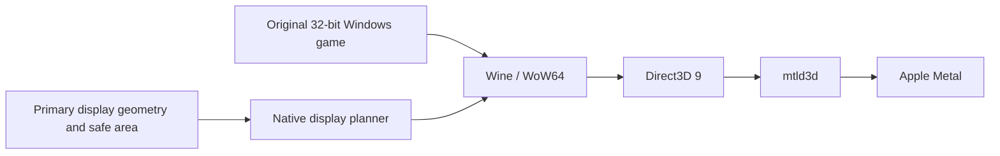

# RA3Mac

An unofficial compatibility project for running the Windows edition of *Command & Conquer: Red Alert 3 – Uprising* on Apple Silicon Macs. RA3Mac keeps the original game engine and connects its Direct3D 9 rendering path to Apple Metal through Rosetta 2, Wine/WoW64, and mtld3d. Its current mainline adds an adaptive fullscreen viewport for the primary display and macOS safe areas.

RA3Mac is not affiliated with or endorsed by Electronic Arts (EA), Apple, or the game's original publishers. Game code, names, artwork, music, and third-party components remain subject to their owners' rights and terms. Packaging a component does not grant additional rights or imply endorsement. See the notices shipped with each edition.

## Release editions

RA3Mac 1.1.0 has two different DMG editions:

| Edition | Contents | Intended for |
| --- | --- | --- |
| **Full App DMG** — `RA3Mac-1.1.0-Full.dmg` | A standalone macOS app with the runtime and game. | Players who want to install the app. |
| **Runtime DMG** — `RA3Mac-1.1.0-Runtime.dmg` | Wine runtime, initialized prefix template, RA3Mac tools and native app-building helpers. It contains no game executable, BIG game archives, player saves, or assembled app. | Owners of a compatible game copy who want to build their own app. |
| **Source archive**, when listed | RA3Mac source and patches. Matching Wine source is published separately as `Wine-3562fea-RA3Mac-source.tar.zst`. | Developers inspecting or rebuilding the sources. |

A source checkout alone does not contain the game or a complete runtime. Check the release page for the exact edition files, checksums, and split-archive instructions.

## What it does

- Runs the original 32-bit Windows game engine; this is not a native rewrite or official macOS port.
- Uses mtld3d to connect the game's Direct3D 9 path to Metal.
- Plans the fullscreen viewport from the primary display geometry and safe area. The outer Wine window spans the display to preserve edge input while the game rendering area avoids notches and other unsafe edges.
- Includes tested display, pointer-mapping, fullscreen-mask, Bloom/Glow compatibility changes, and RA3Mac's timing patch game-timing compatibility payload.
- Keeps writable prefix data, settings, saves, and logs in the user's Application Support container, separate from the app template.
- Disables microphone capture in the bundled Wine CoreAudio path before it accesses input devices; audio output remains available. This describes the packaged Wine configuration only.



## Compatibility and validation

- **Target**: Apple Silicon M1 or later with Rosetta 2 installed.
- **Build target**: packaging tools are compiled against the macOS 15 SDK. Actual game launch and visual checks have been completed on one Apple Silicon Mac with a 2× notched display. Earlier macOS releases have not been runtime-tested.
- **Tested display**: 3024×1964 full display; 3024×1900 game safe viewport and Metal drawable. The candidate was launched and visually checked on the test Mac.
- **Not yet covered**: other M1-or-later hardware, non-notched displays, 1× external displays, multiple or rotated displays, display hot-plug or primary-display changes during play, complete campaign/challenge flows, all save/load and result screens, or long-duration stability.
- **Frame rate**: timing patch is a game-timing compatibility payload. It is not a guarantee of a sustained 60 FPS on every Mac; not every scene has an independent FPS benchmark.
- **Display changes**: the viewport plan is created at launch. Quit and relaunch after changing the primary display or its mode.

A successful build or a local visual check does not certify every Mac, game scenario, or macOS version.

## Install the Full App

1. Download `RA3Mac-1.1.0-Full.dmg` from the release page. Verify the published checksums and review the bundled third-party notices.
2. Open the DMG and drag the app to Applications.
3. Ensure Rosetta 2 is installed, then open the app from Applications.
4. On first launch, the app prepares an independent Wine prefix. Settings and saves are stored in the current user's Application Support directory.

Back up the user data directory before replacing an app or migrating saves. Do not delete the prefix as a troubleshooting shortcut.

## Build an app from the Runtime DMG

The Runtime DMG includes a prepared Wine runtime and prefix template, but deliberately excludes game files, game archives, and saves. Supply your own compatible game copy. The importer verifies the required layout and game identity and refuses an unsupported build. It does not download a game or Wine. The source game directory and prefix are not modified in place.

Mount the Runtime DMG and run these commands from the RA3Mac repository root, adjusting the mounted volume name and paths as needed. Output paths must not already exist.

```sh
python3 -I packaging/macos/import_runtime.py \
  --wine "/Volumes/RA3Mac-1.1.0-Runtime/Runtime/wine" \
  --prefix "/Volumes/RA3Mac-1.1.0-Runtime/Runtime/prefix" \
  --game-dir "/path/to/your/Red Alert 3 Uprising" \
  --output "$HOME/RA3Mac-work/runtime" \
  --presentation safe-area
```

`--game-dir` must contain `Data/ra3ep1_1.0.game`, `Shaders.big`, `Misc.big`, and `StaticStream.big`. The runtime prefix must be initialized. `--payload-dir` is optional; by default the importer uses `drive_c/u60-mtld3d` from the prefix, which carries the RA3Mac timing patch compatibility payload.

Use the launcher, display helpers, planner, and icon included in the Runtime DMG's `Tools` folder:

```sh
python3 -I packaging/macos/release_build.py \
  --runtime-root "$HOME/RA3Mac-work/runtime" \
  --audio-module "/Volumes/RA3Mac-1.1.0-Runtime/Runtime/wine/lib/wine/x86_64-unix/winecoreaudio.so" \
  --icon "/Volumes/RA3Mac-1.1.0-Runtime/Tools/AppIcon.icns" \
  --launcher "/Volumes/RA3Mac-1.1.0-Runtime/Tools/RA3Launcher" \
  --display-helper "/Volumes/RA3Mac-1.1.0-Runtime/Tools/display-mode" \
  --display-plan "/Volumes/RA3Mac-1.1.0-Runtime/Tools/display-plan" \
  --output "$HOME/RA3Mac-work/RA3Mac.app" \
  --presentation safe-area
```

The release builder assembles the app and verifies its code signature. By default it uses an ad-hoc signature and does not notarize the app. It neither installs nor launches the game. Rebuilding Wine from source also requires the toolchain documented by the Wine source and `packaging/macos/README.md`.

## Developer checks

The offline gate requires macOS command-line developer tools, including `xcrun swiftc`, Python 3, Clang, and Git. It compiles and runs geometry, launcher, packaging, and Wine-route checks. It does **not** start Wine, the game, or a graphical UI and does not require game files.

```sh
python3 -I -B research/compat/adaptive-viewport/run_checks.py
```

Additional packaging fixture checks:

```sh
python3 -I -B packaging/macos/test_import_runtime.py
python3 -I -B packaging/macos/test_release_build.py
python3 -I -B packaging/macos/test_build_app.py
```

## User data and privacy

- The writable prefix, game settings, saves, and logs live under `~/Library/Application Support/<App identifier>/`. Back up this directory before upgrading or replacing an app.
- Session diagnostics are written under the same Application Support container in `Logs/`. Review and remove personal information before sharing logs; they can contain local system paths and environment details.
- The packaged Wine configuration disables microphone capture and does not request microphone permission; speaker output remains available.
- RA3Mac makes no claim that all game or Wine network activity is absent. Online features and service availability are outside the current validation scope.
- Do not commit game files, prefixes, saves, logs, signing credentials, or toolchain caches to the source repository.

## Troubleshooting

| Symptom | What to check |
| --- | --- |
| Missing-file or hash-mismatch error | Confirm the Wine/runtime, prefix, game build, mtld3d files, and timing patch payload match the edition requirements. Do not bypass identity checks. |
| Rosetta unavailable | Install Rosetta 2 on Apple Silicon and relaunch the app. |
| Incorrect fullscreen area or edge pointer behavior | Quit the game, restore the intended primary display and mode, then relaunch. Check whether the display setup is among the untested cases above. |
| macOS blocks first launch or signature verification | Confirm the download source, checksums, and signature. A self-built ad-hoc app is not notarized and is not equivalent to a Developer ID release. |
| Game fails to start | Keep the prefix and saves. Inspect the latest launcher and Wine logs under `Logs/`; check free disk space, input identity, and directory permissions. |

When reporting a problem, include the RA3Mac edition/version, Mac chip family, macOS version, display setup, and a privacy-reviewed error summary. Do not attach game files, complete saves, unreviewed logs, or signing credentials.

## Repository map

| Path | Contents |
| --- | --- |
| `packaging/macos/` | macOS launcher, runtime import, app assembly, signing, and packaging fixtures. |
| `packaging/resources/` | Generator and verifier for compatibility resource copies. |
| `research/compat/adaptive-viewport/` | Current adaptive viewport, primary-display planning, Wine patches, and offline gate. |
| `research/compat/fixed-viewport/` | Legacy fixed-size display path and historical checks. |
| `payload/timing/` | RA3Mac timing patch game-timing compatibility payload and identity manifest. |

## Version, contributions, and license

The current mainline contains the adaptive display implementation. The fixed-viewport implementation is retained as a legacy/reference branch. `timing patch` names the game-timing payload; it is not the public app version. Consult the release page for each package's version, contents, checksums, signing, and notarization status.

Reproducible issue reports and improvements are welcome. Run the offline gate before submitting changes. Describe affected modules and add repeatable checks. Do not submit game assets, user data, signing identities, private machine paths, or unreviewed logs.

The original RA3Mac source is licensed under the MIT License. Wine-derived modifications and other bundled third-party components have separate licenses and notices; see [THIRD-PARTY-NOTICES.md](THIRD-PARTY-NOTICES.md) and the license files included with each edition. The game and its content are not covered by RA3Mac's source license.