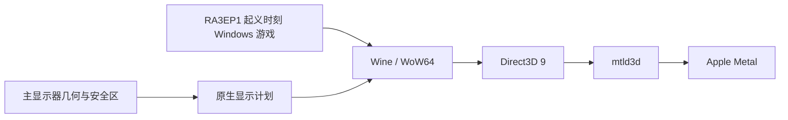

# RA3EP1Mac — 起义时刻

在 Apple Silicon Mac 上运行 Windows 版《命令与征服：红色警戒 3：起义时刻》（Command & Conquer: Red Alert 3 – Uprising，简称 RA3EP1）的非官方兼容项目。它保留原版游戏引擎，通过 Rosetta 2、Wine/WoW64、mtld3d 与 Metal 运行游戏，并为 macOS 全屏窗口和刘海安全区提供适配。

本项目为非官方适配。组件来源与许可见[第三方说明](THIRD-PARTY-NOTICES.md)。

游戏时序补丁（帧率选择与计时修正）的源码与开发位于独立项目 [RA3EP1 FPS Unlock](https://github.com/Rakanrkk/RA3EP1-FPS-Unlock)；本仓库包含它在 macOS 上的集成、打包与发行。

## 发行包

RA3EP1Mac 1.2.0 提供完整版（Standalone）和运行环境（Runtime）两个版本。发布文件顺序与 GitHub 页面一致：

| 文件 | 用途 |
| --- | --- |
| [`RA3EP1Mac-v1.2.0-macos-arm64-runtime.dmg`](https://github.com/Rakanrkk/RA3EP1Mac/releases/download/v1.2.0/RA3EP1Mac-v1.2.0-macos-arm64-runtime.dmg) | 运行环境（Runtime）：Wine 运行时、已初始化 prefix 模板、RA3Mac 工具和 App 构建 helper；不含游戏文件、存档或已组装的 App。 |
| [`RA3EP1Mac-v1.2.0-macos-arm64-standalone.001.dmg`](https://github.com/Rakanrkk/RA3EP1Mac/releases/download/v1.2.0/RA3EP1Mac-v1.2.0-macos-arm64-standalone.001.dmg) | 完整版（Standalone）：含运行时和游戏的即装 App，原生 DMG 第 1 卷。四个分卷须放在同一目录并保持原文件名；只打开本 `.001.dmg`，macOS 会读取其他分卷，无需拼接。 |
| [`RA3EP1Mac-v1.2.0-macos-arm64-standalone.002.dmgpart`](https://github.com/Rakanrkk/RA3EP1Mac/releases/download/v1.2.0/RA3EP1Mac-v1.2.0-macos-arm64-standalone.002.dmgpart) | 完整版原生 DMG 第 2 卷。 |
| [`RA3EP1Mac-v1.2.0-macos-arm64-standalone.003.dmgpart`](https://github.com/Rakanrkk/RA3EP1Mac/releases/download/v1.2.0/RA3EP1Mac-v1.2.0-macos-arm64-standalone.003.dmgpart) | 完整版原生 DMG 第 3 卷。 |
| [`RA3EP1Mac-v1.2.0-macos-arm64-standalone.004.dmgpart`](https://github.com/Rakanrkk/RA3EP1Mac/releases/download/v1.2.0/RA3EP1Mac-v1.2.0-macos-arm64-standalone.004.dmgpart) | 完整版原生 DMG 第 4 卷。 |
| [`RA3EP1Mac-v1.2.0-wine-source.tar.zst`](https://github.com/Rakanrkk/RA3EP1Mac/releases/download/v1.2.0/RA3EP1Mac-v1.2.0-wine-source.tar.zst) | 与 Runtime 版匹配的 Wine 源码归档，含 RA3Mac 补丁。 |
| [`release-manifest.json`](https://github.com/Rakanrkk/RA3EP1Mac/releases/download/v1.2.0/release-manifest.json) | 发行文件清单。 |
| [`SHA256SUMS.txt`](https://github.com/Rakanrkk/RA3EP1Mac/releases/download/v1.2.0/SHA256SUMS.txt) | 所有发行文件的 SHA-256 校验值。 |

单独的源码检出不含游戏或完整运行时。查看 [Release 发布页](https://github.com/Rakanrkk/RA3EP1Mac/releases/latest)并在分发组件前阅读[第三方说明](THIRD-PARTY-NOTICES.md)。

本项目针对独立资料片 **RA3EP1《起义时刻》**，游戏程序为 `ra3ep1_1.0.game`。

## 功能概览

- **原版游戏引擎**：通过 Wine/WoW64 运行 32 位 Windows 游戏程序。
- **Direct3D 9 到 Metal**：通过 mtld3d 将游戏的 D3D9 渲染路径连接到 Metal。
- **启动帧率选择**：启动时选择 60 或 120 FPS（默认 60）。游戏逻辑保持原版 15 Hz；粒子、悬挂等按各自原始节奏运行，画面以更高刷新率插值，详见[帧率选择](#帧率选择)。
- **自适应全屏视口**：启动时读取主显示器几何与安全区。Wine 外层窗口保留整屏范围以接收边缘输入，游戏绘制区域避开刘海等安全边缘。
- **兼容性修正**：保留经过验证的显示、鼠标映射、全屏遮罩和 Bloom／Glow 修改，以及与 RA3EP1 FPS Unlock 同源的时序载荷。
- **独立用户数据**：Standalone 版首次启动时在当前用户的 Application Support 中准备自己的 Wine prefix；游戏设置、存档与日志和 App 模板分开保存。
- **麦克风采集关闭**：随包 Wine CoreAudio 修改在访问输入设备前拒绝录音采集请求，声音输出仍可使用。



## 帧率选择

- 启动窗口提供 **60 FPS** 和 **120 FPS** 两档，默认 60。
- 勾选“记住选择并自动启动”后，下次启动会按上次的选择直接开始；自动开始前约有 2 秒时间可以更改帧率或取消，之后仍可随时退出游戏再重新选择。
- 每档帧率对应独立的时序载荷，随 App 内置并按清单校验 SHA-256；每次启动使用当次会话的副本，不修改 App 内文件。
- 帧率选择不影响存档、设置和录像；切换档位不需要重新安装或迁移数据。
- 不需要选择窗口时，可从命令行以 `--fps 60` 或 `--fps 120` 直接启动。

## 分支与版本

- `main`：当前版本，随 1.2.0 发行。
- `archive/fixed-viewport`：旧固定视口验收版的源码快照，用于回退和对照。

## 支持范围与验证状态

- **目标设备**：Apple Silicon M1 或更新机型，并安装 Rosetta 2。
- **实际游戏测试**：在一台 2× 刘海屏的 Apple Silicon Mac 上完成。60 FPS 是长期使用基准；120 FPS 已通过本机目视验收。
- **已知问题**：天狗（喷气形态）在移动中降落时的变形衔接仍在调查中，进展见 [RA3EP1 FPS Unlock](https://github.com/Rakanrkk/RA3EP1-FPS-Unlock)。
- **尚未覆盖**：其他 Mac 机型、多显示器与运行中更改显示配置、完整战役／挑战、长期稳定性。实际帧率取决于硬件、画质和场景。
- **显示配置变化**：启动器按启动时的主显示器计划游戏区域。游戏运行期间更换主屏或显示模式，需要退出后重新打开应用。

仅支持横屏；更换主屏或缩放后请重启游戏。

## 安装与首次启动

### 使用完整版（Standalone）DMG

1. 从发布页获取完整版的 4 个分卷，并核对发布页提供的校验值和第三方通知。
2. 将 `RA3EP1Mac-v1.2.0-macos-arm64-standalone.001.dmg`、`.002.dmgpart`、`.003.dmgpart` 和 `.004.dmgpart` 下载到同一目录，保持文件名不变；只打开首个 `.001.dmg`，macOS 会自动读取同目录的其余分卷，无需手工拼接。将 App 拖入“应用程序”。
3. 确认系统已安装 Rosetta 2，然后从“应用程序”打开 App。
4. 首次启动会准备独立的游戏 prefix；后续游戏设置与存档保存在当前用户的 Application Support 中。

不要删除用户数据目录来排查启动问题。更换发行包或迁移数据前，先退出游戏并备份存档。

### 从运行环境（Runtime）DMG 构建自己的 App

运行环境 DMG 提供 Wine 运行时、prefix 模板和时序载荷，游戏需自行导入。挂载后的卷内布局：

```text
wine、prefix、timing（随包时序载荷）
Tools/     RA3Launcher、display helper、planner、AppIcon
Source/    与本发行对应的仓库源码导出
```

需要 macOS、Python 3；使用随卷 `Tools` 提供的 helper 时无需 Swift 编译。游戏目录与 prefix 都不会被构建器就地修改。

先从你自己的游戏生成兼容资源副本（含 60/120 通用、与完整版一致的 light 版 `StaticStream.big`）；原始游戏目录保持只读：

```bash
python3 -I packaging/resources/compat_resources.py \
  --game-dir "/path/to/Red Alert 3 Uprising" \
  --output-dir "$HOME/RA3Mac-input/compat-resources" \
  --high-refresh-light
```

把生成的 `Shaders.big`、`Misc.big`、`StaticStream.big` 复制到游戏目录副本的 `Data/` 中，下一步导入该副本。

挂载 Runtime DMG 后，在仓库根目录执行（可直接使用卷内的 `Source/` 目录，或你自己的源码检出）。卷名为 `RA3EP1Mac-1.2.0-Runtime`，下方命令使用该路径；输出目录与 `.app` 目标都必须不存在：

```bash
python3 -I packaging/macos/import_runtime.py \
  --wine "/Volumes/RA3EP1Mac-1.2.0-Runtime/wine" \
  --prefix "/Volumes/RA3EP1Mac-1.2.0-Runtime/prefix" \
  --game-dir "/path/to/game-copy" \
  --output "$HOME/RA3Mac-work/runtime" \
  --presentation safe-area
```

`--game-dir` 应是含有 `Data/ra3ep1_1.0.game` 的游戏目录，且 `Shaders.big`、`Misc.big`、`StaticStream.big` 应位于该目录的 `Data/` 子目录。支持版本与资源会经过 SHA-256 检查；不匹配时导入会失败。

然后使用卷内 `Tools` 的 launcher、display helper、planner 和图标；随包时序载荷通过 `--timing-dir` 传入：

```bash
python3 -I packaging/macos/release_build.py \
  --runtime-root "$HOME/RA3Mac-work/runtime" \
  --audio-module "/Volumes/RA3EP1Mac-1.2.0-Runtime/wine/lib/wine/x86_64-unix/winecoreaudio.so" \
  --icon "/Volumes/RA3EP1Mac-1.2.0-Runtime/Tools/AppIcon.icns" \
  --launcher "/Volumes/RA3EP1Mac-1.2.0-Runtime/Tools/RA3Launcher" \
  --display-helper "/Volumes/RA3EP1Mac-1.2.0-Runtime/Tools/display-mode" \
  --display-plan "/Volumes/RA3EP1Mac-1.2.0-Runtime/Tools/display-plan" \
  --timing-dir "/Volumes/RA3EP1Mac-1.2.0-Runtime/timing" \
  --output "$HOME/RA3Mac-work/RA3Mac.app" \
  --public \
  --presentation safe-area
```

发行构建器会创建并校验 App 签名（默认 ad-hoc 身份，`--public` 写入中性签名说明），不执行公证，也不会安装或启动游戏。若从源码准备和重建 Wine，请参阅仓库中的 `docs/BUILDING.md` 和 Wine 上游构建要求。

## 开发者快速检查

需要 Apple 的命令行开发工具（包括 `xcrun swiftc`）、Python 3、Clang 和 Git。下面的离线门禁会编译并运行几何、启动器、打包检查；**不会启动 Wine、游戏或图形界面**，也不需要游戏文件。

```bash
python3 -I -B research/compat/adaptive-viewport/run_checks.py
```

补充打包输入与发行构建器的独立夹具检查：

```bash
python3 -I -B packaging/macos/test_import_runtime.py
```

```bash
python3 -I -B packaging/macos/test_release_build.py
```

```bash
python3 -I -B packaging/macos/test_build_app.py
```

启动器的命令行帮助和静态资源校验入口为 `RA3Launcher --help` 与 `RA3Launcher --verify-only`。Standalone 版首次准备用户 prefix 时使用 `--prepare-only` 可执行准备步骤而不启动游戏；仅对已构建的 Standalone 版使用这些选项。

## 用户数据、日志与隐私

- Standalone 版的可写 prefix、游戏设置、存档及日志位于 `~/Library/Application Support/org.ra3mac.UprisingMetal.Adaptive/` 下。升级或重新安装 App 前先备份该目录。
- 每次运行的诊断文件写入同一 Application Support 容器下的 `Logs/`。日志可能包含系统路径或环境信息；公开分享前先检查并移除个人数据。
- 打包的 Wine 配置会禁用麦克风采集路径，App 不请求麦克风权限；扬声器输出仍可用。
- 在线功能暂未测试。
- 不要把游戏目录、prefix、存档、日志、签名凭证或工具链缓存提交到源码仓库。

## 故障排查

| 现象 | 建议 |
| --- | --- |
| 启动器提示缺少文件或哈希不匹配 | 确认 Wine、prefix、游戏版本、mtld3d 和时序载荷布局符合该发行版本要求；不要绕过身份校验。 |
| 提示 Rosetta 不可用 | 在 Apple Silicon Mac 上安装并启用 Rosetta 2，然后重新启动 App。 |
| 想更换启动帧率 | 重新打开 App，在选择窗口更改档位；若开启了自动开始，请在窗口出现后约 2 秒内更改。也可用 `--fps 60` / `--fps 120` 直接以指定档位启动。 |
| 全屏区域或鼠标边缘不正确 | 退出游戏，恢复预期的主显示器与显示模式，再启动 App；先确认是否属于尚未验证的显示配置。 |
| 签名或首次打开被系统阻止 | 确认下载来自预期发布页，重新核对校验值和签名状态。发行包使用 ad-hoc 完整性签名，首次打开可在系统隐私与安全性中批准。 |
| 游戏无法启动 | 保留 prefix 与存档，查看最新 `Logs/` 会话中的启动器和 Wine 日志；检查磁盘空间、输入文件身份及目录权限。 |

反馈问题时请提供 RA3EP1Mac 版本、所选帧率、Mac 芯片类别、macOS 版本、显示器布局和已清理隐私信息的错误摘要。请勿附上游戏数据、完整存档、未审查日志或任何签名凭证。

## 仓库导览

| 路径 | 内容 |
| --- | --- |
| `packaging/macos/` | macOS 启动器、运行时导入、App 组装、签名与发行夹具。 |
| `packaging/resources/` | 兼容资源副本生成与校验工具。 |
| `research/compat/adaptive-viewport/` | 当前自适应视口、主显示器计划、Wine 补丁与离线门禁。 |
| `research/compat/fixed-viewport/` | 旧固定尺寸显示路径及历史检查工具。 |
| `payload/timing/` | 随包时序载荷的身份清单与构建说明。时序补丁源码见 [RA3EP1 FPS Unlock](https://github.com/Rakanrkk/RA3EP1-FPS-Unlock)。 |

## 开源致谢

本项目基于以下开源成果构建，感谢上游开发者的工作：

| 项目 | 在本项目中的作用 | 上游与发行源码 | 许可 |
| --- | --- | --- | --- |
| Wine（含 WoW64） | 运行 32 位 Windows 游戏；RA3Mac 的显示和音频补丁基于 Wine 构建。WoW64 是 Wine 的能力。 | [WineHQ](https://www.winehq.org/)；源码分支 [athei/wine](https://github.com/athei/wine)，固定于 `3562fea11d1830725859ac5ed790a3b9789ccd14`；预构建运行时 [athei/wine-build](https://github.com/athei/wine-build)，版本 `cx-26.3.0-7` | LGPL-2.1-or-later |
| mtld3d v0.13.0 | 将游戏的 Direct3D 9 渲染连接到 Metal。 | [athei/mtld3d v0.13.0](https://github.com/athei/mtld3d/releases/tag/v0.13.0) | zlib |
| Noto Sans CJK SC | 发行包中捆绑的简体中文字体。 | [notofonts/noto-cjk](https://github.com/notofonts/noto-cjk) | SIL Open Font License 1.1 |

许可范围与适用说明见[第三方说明](THIRD-PARTY-NOTICES.md)及[匹配的 Wine 补丁源码归档](https://github.com/Rakanrkk/RA3EP1Mac/releases/download/v1.2.0/RA3EP1Mac-v1.2.0-wine-source.tar.zst)。构建时，[LLVM-MinGW](https://github.com/mstorsjo/llvm-mingw) 用于编译 Windows 载荷与 PE 模块；重建 Wine 使用 [GNU Make](https://www.gnu.org/software/make/) 和 [Bison](https://www.gnu.org/software/bison/)。LLVM-MinGW 运行时组件的许可见第三方说明。

## 版本、贡献与许可

项目源码包含自适应显示实现与时序载荷集成；固定视口实现保留为兼容与历史参考。游戏时序补丁的源码与开发位于独立项目 [RA3EP1 FPS Unlock](https://github.com/Rakanrkk/RA3EP1-FPS-Unlock)。每个实际发行包由其发布条目标明版本、内容、签名状态与校验值。

欢迎提交可复现的问题报告和改进。提交前运行上面的离线门禁；补丁应注明影响的模块并添加可重复检查。请勿提交游戏资产、用户数据、签名身份、绝对本机路径或未清理日志。

原生启动器、打包、测试和时序载荷集成等原创源码采用 [MIT 许可](LICENSE)；Wine 衍生补丁保留 LGPL-2.1-or-later 范围。游戏与第三方组件见 [THIRD-PARTY-NOTICES.md](THIRD-PARTY-NOTICES.md)。
