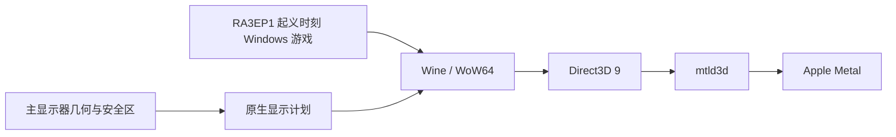

# RA3EP1Mac — 起义时刻

在 Apple Silicon Mac 上运行 Windows 版《命令与征服：红色警戒 3：起义时刻》（Command & Conquer: Red Alert 3 – Uprising）（RA3EP1）的非官方兼容项目。它保留原版游戏引擎，通过 Rosetta 2、Wine/WoW64、mtld3d 与 Metal 运行游戏，并为 macOS 全屏窗口和刘海安全区提供适配。

本项目为非官方适配。组件来源与许可见[第三方说明](THIRD-PARTY-NOTICES.md)。

## 发行包

RA3EP1Mac 1.1.0 提供 Full 和 Runtime 两个下载项，内容见下表。

| 发行包 | 内容 | 适合谁 |
| --- | --- | --- |
| **完整 App DMG** — `RA3EP1Mac-1.1.0-Full.dmg` | 可拖入“应用程序”的独立 App、运行时与游戏。 | 想直接安装的玩家。 |
| **Runtime DMG** — `RA3EP1Mac-1.1.0-Runtime.dmg` | Wine 运行时、已初始化 prefix 模板、RA3Mac 自有工具和 App 构建所需原生 helper；不含游戏可执行文件、游戏 BIG 资源、用户存档或已组装 App。 | 已有兼容游戏副本、希望自己构建 App 的用户。 |
| **源码归档** — 发布页提供时 | RA3Mac 源码与补丁；配套 Wine 源码以 `Wine-3562fea-RA3Mac-source.tar.zst` 单独发布。 | 希望查看或重建源码的开发者。 |

下载文件、分卷和SHA-256校验值见[Release](https://github.com/Rakanrkk/RA3EP1Mac/releases/latest)。

本项目针对独立资料片 **RA3EP1《起义时刻》**，游戏程序为`ra3ep1_1.0.game`。

## 功能概览

- **原版游戏引擎**：通过Wine/WoW64运行32位Windows游戏程序。
- **Direct3D 9 到 Metal**：通过 mtld3d 将游戏的 D3D9 渲染路径连接到 Metal。
- **自适应全屏视口**：启动时读取主显示器几何与安全区。Wine 外层窗口保留整屏范围以接收边缘输入，游戏绘制区域避开刘海等安全边缘。
- **兼容性修正**：保留经过验证的显示、鼠标映射、全屏遮罩和 Bloom／Glow 兼容修改，以及 RA3Mac 的 游戏时序补丁。
- **独立用户数据**：完整 App 首次启动时在当前用户的 Application Support 中准备自己的 Wine prefix；游戏设置、存档与日志和 App 模板分开保存。
- **麦克风采集关闭**：随包 Wine CoreAudio 修改在访问输入设备前拒绝录音采集请求，声音输出仍可使用。



## 分支与版本

- `main`：当前版本，随1.1.0发行。
- `archive/fixed-viewport`：旧固定3024×1900验收版的源码快照，用于回退和对照。

## 支持范围与验证状态

- **目标设备**：Apple Silicon M1 或更新机型，并安装 Rosetta 2。
- **构建目标**：原生工具以 macOS 15 部署目标编译（实际SDK取决于构建工具链）。项目的实际游戏运行与目视检查目前只在一台 Apple Silicon Mac 和一块 2× 刘海显示屏上完成；较早 macOS 版本尚未经过实际运行验证。
- **已验证显示情形**：测试机的整屏为 3024×1964 像素，游戏安全绘制区及 Metal drawable 为 3024×1900 像素。实际启动后完成了本机画面检查。
- **仍待验证**：其他 M1 或更新设备、无刘海内屏、1× 外接屏、多显示器、竖屏、运行中热插拔或切换主屏，以及完整战役、挑战、所有存读档／结算情形和长期稳定性。
- **帧率说明**：使用时序补丁时序补丁；实际帧率取决于硬件、画质和场景，尚无完整跨设备基准。
- **显示配置变化**：启动器按启动时的主显示器计划游戏区域。游戏运行期间更换主屏或显示模式，需要退出后重新打开应用。

竖屏暂不支持；更换主屏或缩放后请重启游戏。

## 安装与首次启动

### 使用完整 App DMG

1. 从所需版本的发布页获取完整 App DMG，并核对发布页提供的校验值和第三方通知。
2. 完整版由4个原生DMG分卷组成：下载`RA3EP1Mac-1.1.0-Full.dmg`及同名`.002.dmgpart`、`.003.dmgpart`、`.004.dmgpart`到同一目录，保持文件名，然后只打开首个`.dmg`。系统会自动读取其余分卷，无需手工拼接。将App拖入“应用程序”。
3. 确认系统已安装 Rosetta 2，然后从“应用程序”打开 App。
4. 首次启动会准备独立的游戏 prefix；后续游戏设置与存档保存在当前用户的 Application Support 中。

不要删除用户数据目录来排查启动问题。更换发行包或迁移数据前，先退出游戏并备份存档。

### 从 Runtime DMG 构建自己的 App

Runtime DMG提供Wine运行时和prefix模板，游戏需自行导入。使用自己的游戏副本，依照下面的命令导入并构建。需要 macOS、Python 3；若使用随 DMG 提供的 Tools helper，可略过 Swift 编译。游戏目录与 prefix 都不会被构建器就地修改。

挂载 Runtime DMG 后，在仓库根目录执行。请按实际挂载位置调整路径；输出目录与 `.app` 目标都必须不存在：

```bash
python3 -I packaging/macos/import_runtime.py \
  --wine "/Volumes/RA3EP1Mac-1.1.0-Runtime/Runtime/wine" \
  --prefix "/Volumes/RA3EP1Mac-1.1.0-Runtime/Runtime/prefix" \
  --game-dir "/path/to/your/Red Alert 3 Uprising" \
  --output "$HOME/RA3Mac-work/runtime" \
  --presentation safe-area
```

`--game-dir` 应是含有 `Data/ra3ep1_1.0.game`、`Shaders.big`、`Misc.big` 和 `StaticStream.big` 的游戏目录。支持版本与资源会经过 SHA-256 检查；不匹配时导入会失败。`--payload-dir` 可选，默认为 prefix 中的 `drive_c/u60-mtld3d`，其中包含随 Runtime DMG 提供的 RA3Mac 时序补丁 兼容载荷。

然后使用 Runtime DMG 的 `Tools` 目录中随包提供的 launcher、display helper、planner 和图标：

```bash
python3 -I packaging/macos/release_build.py \
  --runtime-root "$HOME/RA3Mac-work/runtime" \
  --audio-module "/Volumes/RA3EP1Mac-1.1.0-Runtime/Runtime/wine/lib/wine/x86_64-unix/winecoreaudio.so" \
  --icon "/Volumes/RA3EP1Mac-1.1.0-Runtime/Tools/AppIcon.icns" \
  --launcher "/Volumes/RA3EP1Mac-1.1.0-Runtime/Tools/RA3Launcher" \
  --display-helper "/Volumes/RA3EP1Mac-1.1.0-Runtime/Tools/display-mode" \
  --display-plan "/Volumes/RA3EP1Mac-1.1.0-Runtime/Tools/display-plan" \
  --output "$HOME/RA3Mac-work/RA3Mac.app" \
  --presentation safe-area
```

发行构建器会创建并校验 App 签名，但默认使用 ad-hoc 身份且不执行公证。它不会安装或启动游戏。若从源码准备和重建 Wine，请参阅仓库中的 `docs/BUILDING.md` 和 Wine 上游构建要求。
## 开发者快速检查

需要 Apple 的命令行开发工具（包括 `xcrun swiftc`）、Python 3、Clang 和 Git。下面的离线门禁会编译并运行几何、启动器、打包检查；准备Wine源码后还可运行实际函数路由检查；**不会启动 Wine、游戏或图形界面**，也不需要游戏文件。

```bash
python3 -I -B research/compat/adaptive-viewport/run_checks.py
```

补充打包输入与发行构建器的独立夹具检查：

```bash
python3 -I -B packaging/macos/test_import_runtime.py
```

```bash
python3 -I -B packaging/macos/test_release_build.py
```

```bash
python3 -I -B packaging/macos/test_build_app.py
```

启动器的命令行帮助和静态资源校验入口为 `RA3Launcher --help` 与 `RA3Launcher --verify-only`。完整 App 首次准备用户 prefix 时使用 `--prepare-only` 可执行准备步骤而不启动游戏；仅对已构建的完整 App 使用这些选项。

## 从个人游戏副本构建完整 App

完整构建需要一份已初始化的 Wine prefix 和符合支持布局的 Wine 运行时。所有输入都应放在仓库外的独立目录；不要直接修改唯一的游戏安装或正在使用的 prefix。示例路径是你自己的路径，输出目录必须事先不存在。

1. **准备兼容资源副本（可选）**。脚本只接受已知原始归档或已接受的修改版本，并会校验输出哈希；原游戏目录只读。把生成的归档放进游戏目录的独立副本中：

   ```bash
   python3 -I packaging/resources/compat_resources.py \
     --game-dir "/path/to/Red Alert 3 Uprising" \
     --output-dir "$HOME/RA3Mac-input/compat-resources"
   ```

2. **准备隔离的 Wine 源码**。`--source` 指向干净的 Wine 源码 Git checkout，且必须位于项目要求的确切提交。脚本在新目录应用 RA3Mac 显示和音频补丁，不修改来源 checkout：

   ```bash
   python3 -I packaging/macos/prepare_wine_source.py \
     --source "/path/to/wine-source" \
     --output "$HOME/RA3Mac-input/wine-source"
   ```

3. **导入运行时与 prefix**。准备一份包含 Wine 及 mtld3d 文件的运行时目录，以及已经初始化、可用的 prefix。游戏目录应含 `Data/ra3ep1_1.0.game` 和要求的资源；若刚生成兼容资源，先将它们放入该游戏目录副本。默认使用游戏目录和补丁载荷都在 prefix 中的布局；也可传入独立目录：

   ```bash
   python3 -I packaging/macos/import_runtime.py \
     --wine "/path/to/wine-runtime" \
     --prefix "/path/to/initialized-prefix" \
     --game-dir "/path/to/game-copy" \
     --payload-dir "payload/timing" \
     --output "$HOME/RA3Mac-input/runtime"
   ```

4. **编译并叠加 Wine 模块**。需要与所选 Wine 源码匹配的 macOS 编译环境、`gmake`、Bison 和 LLVM-MinGW 工具链。命令只构建 RA3Mac 所需的三个 Wine Unix 模块，并写入导入后的运行时副本：

   ```bash
   python3 -I packaging/macos/build_wine_modules.py \
     --source "$HOME/RA3Mac-input/wine-source" \
     --build-dir "$HOME/RA3Mac-input/wine-build" \
     --runtime-root "$HOME/RA3Mac-input/runtime" \
     --toolchain-bin "/path/to/llvm-mingw/bin" \
     --make gmake --jobs 8
   ```

5. **组装并签名 App**。准备有权使用和分发的 `.icns` 图标文件；输出 `.app` 必须是全新路径。默认代码签名为 ad-hoc，不会为 App 公证：

   ```bash
   python3 -I packaging/macos/release_build.py \
     --runtime-root "$HOME/RA3Mac-input/runtime" \
     --audio-module "$HOME/RA3Mac-input/runtime/wine/lib/wine/x86_64-unix/winecoreaudio.so" \
     --icon "/path/to/cleared-app-icon.icns" \
     --output "$HOME/RA3Mac-output/RA3Mac.app" \
     --presentation safe-area
   ```

发行构建器会编译原生工具、组装App并验证签名。命令选项见各脚本的`--help`；源码构建详见[BUILDING](docs/BUILDING.md)。

## 用户数据、日志与隐私

- 完整 App 的可写 prefix、游戏设置、存档及日志位于 `~/Library/Application Support/org.ra3mac.UprisingMetal.Adaptive/` 下。升级或重新安装 App 前先备份该目录。
- 每次运行的诊断文件写入同一 Application Support 容器下的 `Logs/`。日志可能包含系统路径或环境信息；公开分享前先检查并移除个人数据。
- 打包的 Wine 配置会禁用麦克风采集路径，App 不请求麦克风权限；扬声器输出仍可用。
- 在线功能暂未测试。
- 不要把游戏目录、prefix、存档、日志、签名凭证或工具链缓存提交到源码仓库。

## 故障排查

| 现象 | 建议 |
| --- | --- |
| 启动器提示缺少文件或哈希不匹配 | 确认 Wine、prefix、游戏版本、mtld3d 和 时序补丁 载荷布局符合该发行版本要求；不要绕过身份校验。 |
| 提示 Rosetta 不可用 | 在 Apple Silicon Mac 上安装并启用 Rosetta 2，然后重新启动 App。 |
| 全屏区域或鼠标边缘不正确 | 退出游戏，恢复预期的主显示器与显示模式，再启动 App；先确认是否属于尚未验证的显示配置。 |
| 签名或首次打开被系统阻止 | 确认下载来自预期发布页，重新核对校验值和签名状态。发行包使用ad-hoc完整性签名，首次打开可在系统隐私与安全性中批准。 |
| 游戏无法启动 | 保留 prefix 与存档，查看最新 `Logs/` 会话中的启动器和 Wine 日志；检查磁盘空间、输入文件身份及目录权限。 |

反馈问题时请提供 RA3Mac 发行版本、Mac 芯片类别、macOS 版本、显示器布局和已清理隐私信息的错误摘要。请勿附上游戏数据、完整存档、未审查日志或任何签名凭证。

## 仓库导览

| 路径 | 内容 |
| --- | --- |
| `packaging/macos/` | macOS 启动器、运行时导入、App 组装、签名与发行夹具。 |
| `packaging/resources/` | 兼容资源副本生成与校验工具。 |
| `research/compat/adaptive-viewport/` | 当前自适应视口、主显示器计划、Wine 补丁与离线门禁。 |
| `research/compat/fixed-viewport/` | 旧固定尺寸显示路径及历史检查工具。 |
| `payload/timing/` | RA3Mac 时序补丁 游戏时序兼容补丁及身份清单。 |

## 版本、贡献与许可

项目源码包含自适应显示实现；固定视口实现保留为兼容与历史参考。公开分支`main`为当前自适应版，`archive/fixed-viewport`保存旧的固定3024×1900验收版。源码中的 `时序补丁` 指游戏补丁版本，不代表公开 App 发行版本。每个实际发行包应由其发布条目标明版本、内容、签名、公证状态与校验值。

欢迎提交可复现的问题报告和改进。提交前运行上面的离线门禁；补丁应注明影响的模块并添加可重复检查。请勿提交游戏资产、用户数据、签名身份、绝对本机路径或未清理日志。

原生启动器、打包、测试和独立时序补丁等原创源码采用 [MIT许可](LICENSE)；Wine衍生补丁保留LGPL-2.1-or-later范围。游戏与第三方组件见 [THIRD-PARTY-NOTICES.md](THIRD-PARTY-NOTICES.md)。